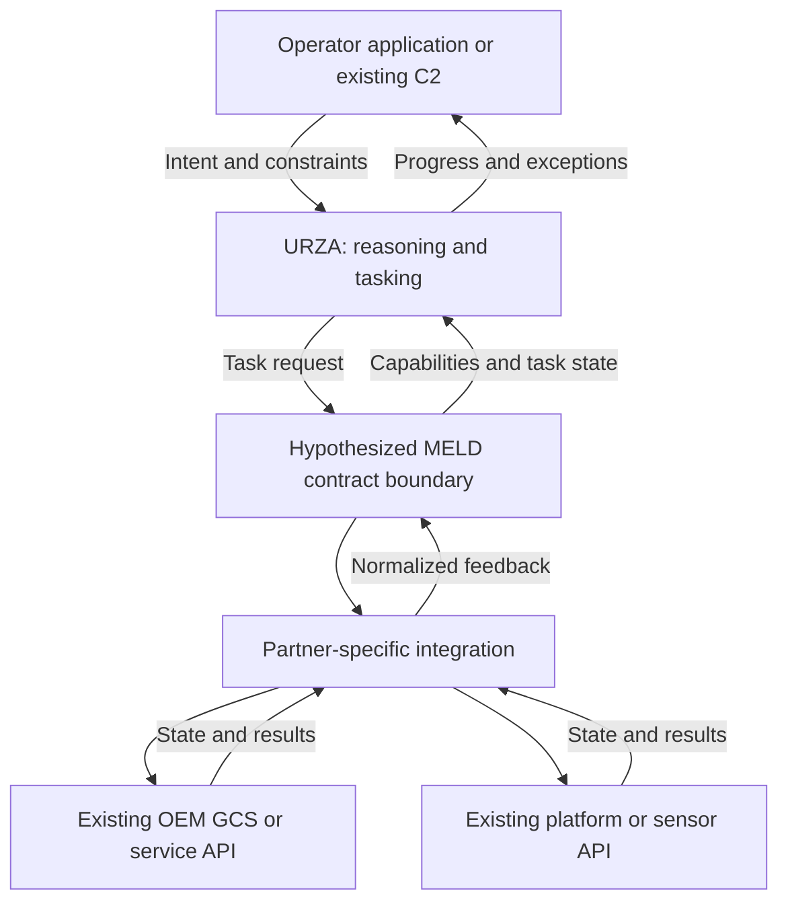
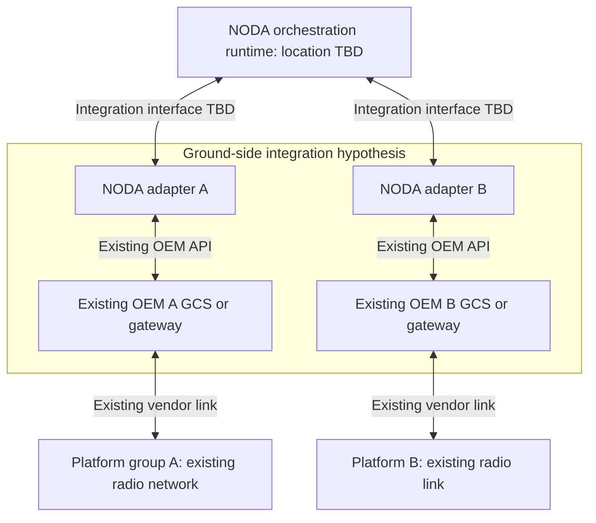
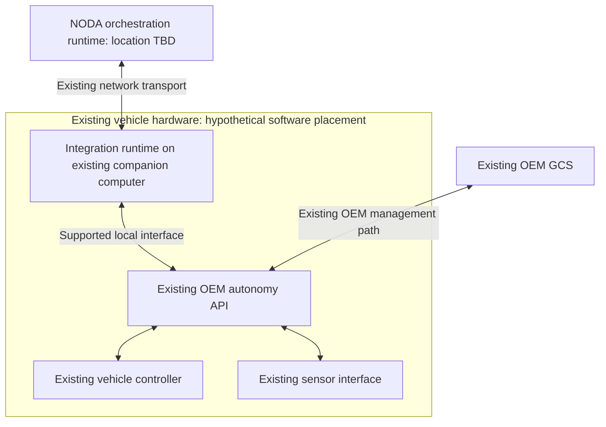
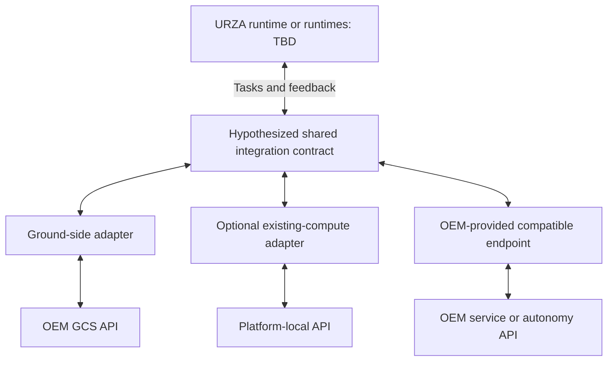

# NODA AI: Architecture and Integration Work Clarifications

An English discussion guide for the **Systems Software Integration Engineer — Taiwan** interview.

**Goal:** understand the product boundaries, locate the integration work, and learn what this engineer would own from a partner's first connection through a supported release.

**Public sources reviewed:** October 23, 2026. All diagrams are candidate hypotheses for discussion, not NODA architecture documentation. Component names such as “adapter” and “execution supervisor” are descriptive placeholders unless the interviewer confirms them.

## 1. Start with a concrete walkthrough

> I have been reading about MELD and URZA, and I drew a few possible integration boundaries. I would like to check my understanding rather than assume a particular implementation. Could we walk through a representative platform integration, using a non-sensitive example such as reading a sensor or requesting a health report? I am particularly interested in where the software runs, which interface it uses, and what the Taiwan integration engineer owns.

Let the engineer describe the system first. Then use the diagrams to resolve differences. Ask for interface shapes, ownership, and development practices; a representative example is enough.

### If only ten minutes are available

1. **Deployment:** Where does a typical partner adapter run, and what already exists at that location? See [Q2](#q2-where-does-the-integration-code-run).
2. **MELD contract:** What does an engineer implement to make a new platform MELD-compatible? See [Q1](#q1-what-is-the-meld-integration-contract).
3. **Execution ownership:** Who turns a task into platform requests and decides whether it actually completed? See [Q3](#q3-who-owns-task-execution-and-supervision).
4. **Concrete deliverable:** Could you describe one recent integration, its hardest issue, and the artifacts required for acceptance? See [Q9](#q9-what-does-a-completed-integration-look-like).
5. **Role boundary:** Which decisions and code changes would I own locally, and which need the core engineering or OEM team? See [Q10](#q10-what-would-i-own-in-taiwan).

For a longer discussion, spend roughly five minutes on the walkthrough, ten on deployment and interfaces, ten on validation and ownership, and five reading back what you learned. Fit this into the interviewer's agenda.

## 2. Establish the evidence before drawing conclusions

| Topic | What the public material supports | What still needs confirmation |
| --- | --- | --- |
| MELD | NODA calls MELD its open integration standard. [S1](https://nodaintelligence.ai/) | Is the integration surface a specification, SDK, service API, runtime, or a combination? What does “open” mean for implementers? |
| URZA | NODA describes a reasoning engine and task broker that translates intent and adapts tasking. [S1](https://nodaintelligence.ai/) | Runtime placement, adapter boundaries, and division of responsibility with existing platform autonomy. |
| Existing platforms | NODA's announcement says its integration platform requires no hardware or software changes to OEM or government platforms. Its technology page also emphasizes hardware independence. [S4](https://nodaintelligence.ai/news/department-of-war-awards-noda-ai-100-million-to-scale-mission-command-for-autonomous-forces-across-the-joint-force/), [S2](https://nodaintelligence.ai/solutions/) | Preconditions, supported interfaces, and where NODA-owned integration code executes. |
| Distributed operation | NODA describes continuity under impaired communications. [S1](https://nodaintelligence.ai/) | Which functions remain available locally and what guarantees apply to a particular integration. |
| Taiwan role | The posting covers adapter development, cross-layer diagnosis, validation, partner coordination, interface documentation, and observability. [S5](https://jobs.ashbyhq.com/noda-ai/8253e820-f565-4428-8aaf-b6284ca2d450) | The first assignment, ownership boundaries, available support, and acceptance criteria. |

### Working interpretation of MELD and URZA

Treat **MELD as the integration boundary** and **URZA as the reasoning/tasking responsibility** until the engineer provides a more precise model. This is a useful starting abstraction, not a verified software stack.

The description of MELD as a universal middleware layer is a working interpretation. The reviewed public pages do not provide enough detail to identify a public MELD schema, SDK, conformance suite, or source-code license. Ask for the appropriate documentation rather than treating “open standard” as proof of open-source implementation.

Likewise, “task broker” describes URZA's application role. It does not establish that URZA is a transport broker or a Zenoh router. The job posting mentions Zenoh or comparable middleware, but it does not establish that MELD equals Zenoh or that every connection uses it.

The key question behind “no platform modifications” is: **what existing capability and accessible interface must a partner already provide?** Integration code can adapt an available capability; a new message format alone cannot create a missing platform capability.

## 3. Diagram 1 — Logical responsibilities, before deployment

**Hypothesis H1:** there is a common capability/task contract between orchestration and platform-specific integrations. The named boxes below are conceptual responsibilities; they may be combined, split, or called something else in the actual product.



**Ask while showing it:**

> Which of these boundaries actually exists? Where would you place MELD, the partner adapter, and execution supervision? Is the integration contract primarily about messages, or does it also define capabilities, task states, and failure semantics?

**What the answer changes:** whether the work is primarily protocol adaptation, capability modeling, application state management, or a combination. Ask which box corresponds to a repository or package that the Taiwan engineer would modify.

**Source anchor:** NODA's [URZA and capability-abstraction overview](https://nodaintelligence.ai/) and [platform principles](https://nodaintelligence.ai/solutions/). The specific contract and feedback arrows above are hypotheses.

## 4. Deployment alternatives to test

These are alternatives to compare, not three asserted NODA configurations. Ask which one is representative, which is unsupported, and what is missing. Logical responsibilities and physical deployment are separate questions.

### Diagram 2 — H2: External integration through existing ground interfaces

This develops the original sketch's ground-interface idea while separating an OEM GCS from a NODA adapter. The adapter could be a separate process or host; co-location is not assumed.



**Question:**

> Can a platform be integrated entirely through an existing ground-side API, with its onboard software left unchanged? If so, does NODA talk to an OEM GCS, a headless gateway, or another service? What functionality must that interface expose?

**Evidence that would support H2:** an existing API carries the required requests and feedback, with the adapter deployed outside the vehicle. **Evidence against it for that integration:** required functionality is available only through another interface or a vehicle-side runtime.

**Possible work to confirm:** API adaptation, status normalization, service deployment, connection handling, and integration tests. Ask whether the OEM GCS is an operator UI, an essential execution dependency, or both.

**Source anchor:** NODA's [no-modifications announcement](https://nodaintelligence.ai/news/department-of-war-awards-noda-ai-100-million-to-scale-mission-command-for-autonomous-forces-across-the-joint-force/) motivates testing this interpretation, but does not prove this topology.

### Diagram 3 — H3: A runtime on an existing onboard computer

This is a contrasting hypothesis to challenge, particularly against the no-software-modifications statement. Existing hardware does **not** by itself make installing a new process consistent with that statement.



**Question:**

> Is deploying an integration process on an existing companion computer ever part of the supported model, or would that be outside the no-modifications approach? If it is supported, who installs, updates, and supports that process, and what exactly remains unchanged on the OEM side?

**Evidence that would support H3:** the engineer confirms a supported local software deployment and explains its relationship to the public claim. **Evidence against it:** integration is entirely external, or the only onboard software is the OEM's pre-existing stack.

**Possible work to confirm:** packaging, Linux process supervision, local API integration, resource limits, diagnostics, and compatibility testing. Do not infer a required Jetson, a particular CPU architecture, or new vehicle hardware from this sketch.

**Source anchor:** compare the [hardware-independent positioning](https://nodaintelligence.ai/solutions/) with the broader [hardware-and-software modification claim](https://nodaintelligence.ai/news/department-of-war-awards-noda-ai-100-million-to-scale-mission-command-for-autonomous-forces-across-the-joint-force/).

### Diagram 4 — H4: Mixed integration paths behind one contract

**Hypothesis:** different partners can expose different integration surfaces while presenting a shared capability model upstream. Common semantics would not require identical deployment locations.



**Question:**

> Is the goal to standardize what an integrated capability means while allowing several deployment patterns? If so, which patterns already have reusable SDKs or adapters, and where does a new partner require custom engineering?

**Evidence that would support H4:** examples of at least two supported integration paths using a common contract. **Evidence against it:** one mandatory integration location or interface for all supported partners.

**Possible work to confirm:** reusable adapter design, contract compatibility, partner-specific capability profiles, and a test matrix across supported configurations.

**Source anchor:** NODA's [vendor-neutral platform principles](https://nodaintelligence.ai/solutions/) motivate this question. The three paths and optional onboard adapter are not documented product features.

### How the original sketch has been reframed

| Original assumption | Better question to test |
| --- | --- |
| Each radio network terminates at a GCS that performs translation | Where does the adapter run, and is the GCS UI separate from the integration service? |
| Zenoh is the GCS-to-C2 connection | Which links actually use Zenoh, and is it visible to partner developers? |
| 433 MHz and 915 MHz identify the two example networks | What network services and constraints does each supplied radio expose? The original frequencies were illustrative, not verified NODA bands or deployment choices. |
| Different platforms require different ground radios | What existing network infrastructure is provided, and who owns its integration and qualification? |
| “Champion Computer” | The intended term is **companion computer**; its presence and role remain platform-dependent. |

Neither an RF band nor a middleware name specifies the whole communication path. Ask separately about the application contract, network transport, and supplied radio/network system. Do not infer a custom CDMA network from an interviewer's previous wireless experience.

## 5. Questions for a deeper technical discussion

Use these as follow-ups to the walkthrough, not a checklist to read aloud. Record the actual component, owner, and evidence behind each answer.

### Q1. What is the MELD integration contract?

**Source anchor:** [NODA overview — MELD](https://nodaintelligence.ai/).

> If I were onboarding a new sensor platform, what would I receive from NODA, and what would I implement to satisfy the MELD contract?

Follow up on the SDK or schema, capability description, interface versioning, and compatibility checks. Ask to distinguish mandatory fields and behavior from partner-specific extensions. What makes an implementation conformant, and who signs it off?

**Capture:** interface name, version, implementation artifact, owner, and validation method.

### Q2. Where does the integration code run?

**Source anchor:** [NODA integration announcement](https://nodaintelligence.ai/news/department-of-war-awards-noda-ai-100-million-to-scale-mission-command-for-autonomous-forces-across-the-joint-force/) and [technology page](https://nodaintelligence.ai/solutions/).

> Which deployment sketch is closest to a typical integration? Could you mark the process and host boundaries, including which components are supplied by the OEM?

Clarify the runtime, language, operating system, deployment mechanism, supported hardware, and release owner. Ask how an integration proceeds when the required OEM API is unavailable. Is that an unsupported capability, a partner prerequisite, or a separately scoped change?

**Capture:** host, process, interface, prerequisites, and responsibility for installation and updates.

### Q3. Who owns task execution and supervision?

**Source anchor:** [URZA overview](https://nodaintelligence.ai/) and [NODA's Intent Custody principle](https://nodaintelligence.ai/about/).

> For a simple sensor-data request, which component accepts the task, invokes the platform interface, observes progress, and decides that the result is complete? Where does an existing GCS participate?

Ask whether “supervision” is a separate service, adapter responsibility, or part of the existing OEM stack. What evidence can the operator inspect when the request was accepted but no result arrived?

| Distinction to clarify | Question |
| --- | --- |
| Transport delivery vs. application acceptance | Who knows that the recipient understood the request? |
| Acceptance vs. completion | Which result or observation demonstrates completion? |
| Connectivity loss vs. task failure | How are these represented separately? |
| Retry vs. a new request | Which layer owns duplicate handling and request identity? |
| Timeout vs. known outcome | Can the interface represent an unknown outcome? |

These are proposed interview distinctions, not a claimed MELD state machine. For protocol background, the [MAVLink command documentation](https://mavlink.io/en/services/command.html) explicitly distinguishes ordinary command acceptance from completion.

**Capture:** lifecycle owner, outcome evidence, and the engineer's responsibility at each boundary.

### Q4. What happens when an abstract capability has no native equivalent?

**Source anchor:** [NODA capability abstraction](https://nodaintelligence.ai/) and [open architecture principles](https://nodaintelligence.ai/solutions/).

> If two sensors expose different sampling modes or timestamp semantics, where are those differences represented? What happens when one platform cannot provide the requested capability?

Ask how the team separates conversion of data formats from semantic adaptation. Who decides whether a capability is unsupported, partially supported, or needs an OEM change? How are units, coordinate frames, time sources, and limitations documented?

**Capture:** capability negotiation or declaration, rejection behavior, and the owner of semantic decisions.

### Q5. Where does Zenoh fit, and what does multicast refer to?

**Source anchor:** [Taiwan job posting](https://jobs.ashbyhq.com/noda-ai/8253e820-f565-4428-8aaf-b6284ca2d450). Technical background: [Zenoh deployment documentation](https://zenoh.io/docs/getting-started/deployment/).

> Does a partner adapter use Zenoh directly, or does a NODA SDK hide transport details? When the role mentions multicast, is the relevant work discovery, application data, or integration with another network component?

Zenoh documents peer, client, and router deployment modes and multicast-based discovery. That does not establish NODA's configuration or imply that application data is multicast over every radio link.

Ask which configuration is supported, how restricted discovery environments are handled, and who owns middleware version compatibility. Does the assignment include commissioning radios, or integrating software over a partner-provided network? For capacity or co-site interference problems, clarify the diagnostics expected from this role and when a network or RF specialist joins the investigation.

**Capture:** middleware boundary, supported configuration, diagnostic access, and specialist ownership.

### Q6. How are platform identity and current state represented?

**Source anchor:** [NODA interoperability principles](https://nodaintelligence.ai/about/). This is a proposed integration-contract question; the public page does not specify an identity mechanism.

> How does a stable platform identity map to its current process, middleware session, and OEM protocol address? What changes after a restart or hardware replacement?

Ask whether the integration engineer manages registration and mappings or consumes an existing service. How are duplicate identities, stale telemetry, and incompatible schema versions surfaced? Which component authorizes an adapter to represent a platform?

**Capture:** identity source, mapping owner, freshness rules, and the available validation checks.

### Q7. What behavior is specified for interruptions and recovery?

**Source anchor:** [NODA's communications-resilience description](https://nodaintelligence.ai/).

> For a representative sensor integration, what behavior is the adapter required to provide when the upstream service or partner connection disappears and later returns?

Keep the discussion at the software contract: what state is local, which observations become stale, whether data is buffered, how resource use is bounded, and how recovery is tested. Ask who specifies the behavior and which outcomes the platform can actually guarantee.

**Capture:** documented failure behavior, local responsibility, recovery criteria, and test ownership.

### Q8. How do engineers trace a cross-system failure?

**Source anchor:** [Taiwan job posting](https://jobs.ashbyhq.com/noda-ai/8253e820-f565-4428-8aaf-b6284ca2d450).

> If the UI shows that a sensor request was accepted but the expected result never appears, how would your team trace it across the integration boundaries?

Ask what logs, correlation identifiers, metrics, packet captures, and replay fixtures are normally available. What is the minimum useful evidence package for the core team or an OEM? Who remains responsible while another team investigates?

**Capture:** trace path, tools, reproducible evidence, escalation boundary, and closure owner.

### Q9. What does a completed integration look like?

**Source anchor:** [Taiwan job posting](https://jobs.ashbyhq.com/noda-ai/8253e820-f565-4428-8aaf-b6284ca2d450) and [NODA's simulation overview](https://nodaintelligence.ai/solutions/).

> Could you walk me through a recent integration from its first working connection to acceptance? What had to be delivered besides the adapter itself?

Ask which lab equipment, simulators, recorded data, and CI infrastructure are already provided. What is checked in bench testing, software-in-the-loop, hardware-in-the-loop, and deployment validation? Which tests remain the OEM's responsibility?

**Capture:** acceptance criteria, reviewer, repeatable test evidence, supported version matrix, and release artifacts.

### Q10. What would I own in Taiwan?

**Source anchor:** [Taiwan job posting](https://jobs.ashbyhq.com/noda-ai/8253e820-f565-4428-8aaf-b6284ca2d450).

> For my first integration, which code and technical decisions would I own, and where would I work with core platform engineers, the OEM, or a specialist?

Ask for a representative week: implementation, diagnosis, validation, partner meetings, documentation, and deployment support. Are engineers expected to change core services, contribute reusable adapters, or primarily deliver partner-specific integrations? When a cause is inside OEM firmware or a board support package, who implements the fix and who verifies closure? Who reviews the work across time zones?

**Capture:** first deliverable, decision authority, reviewer, supporting teams, and realistic allocation of time.

### Q11. Who owns compatibility after the first release?

**Source anchor:** [NODA's vendor-neutral integration positioning](https://nodaintelligence.ai/solutions/).

> When an OEM changes its firmware or API, who assesses the impact, runs regression tests, and approves the new supported combination?

Ask about version pinning, compatibility policy, rollout and rollback procedures, and support handover. Does the same integration engineer maintain the adapter throughout its lifecycle?

**Capture:** maintenance owner, release gate, compatibility evidence, and support expectations.

### Q12. What would successful onboarding look like?

**Source anchor:** [Taiwan role and growth path](https://jobs.ashbyhq.com/noda-ai/8253e820-f565-4428-8aaf-b6284ca2d450).

> What would you want me to demonstrate in the first 30, 60, and 90 days? Which integration would be a useful first assignment, and what documentation, equipment, and engineering support would be available?

Ask which capabilities are expected on day one and which can be learned with the team. If documentation, hardware, or development access is pending, what work can begin first, and who coordinates those dependencies?

**Capture:** measurable outcomes, prerequisites, support, and the first review point.

## 6. Translate the discussion into actual work

The following are **candidate deliverables to validate**, not a promise about NODA's internal process. Use them to turn broad answers into a concrete work breakdown.

| Work area | Possible artifact to ask about | Ownership question |
| --- | --- | --- |
| Interface discovery | Interface inventory, sample exchanges, capability gaps | Who supplies and approves the partner contract? |
| Adapter implementation | Reviewed code, package, configuration, API tests | Is this owned by Taiwan, core engineering, or the OEM? |
| Semantic integration | Capability profile, units/time mapping, documented limitations | Who approves the meaning of a successful result? |
| Runtime integration | Installation procedure, service health checks, resource measurements | Who owns the host environment and operational support? |
| Failure diagnosis | Minimal reproducer, trace bundle, causal explanation | Who coordinates a fix spanning multiple teams? |
| Validation | Repeatable fixtures, regression suite, acceptance report | Who decides that the integration is ready? |
| Partner handover | Interface Control Document, compatibility matrix, runbook | Who maintains these after the initial delivery? |
| Ongoing support | Upgrade assessment, reproducible field report, maintenance change | What is the expected support and travel commitment? |

One useful follow-up throughout the discussion:

> Could you show me the shape of that deliverable, or describe what was accepted for a previous integration?

## 7. Record what changed in the architecture model

Do not convert a plausible answer into a universal rule. Record whether it describes one partner, the current default, or a product-wide requirement.

| Hypothesis | Current status | Evidence to request | Impact on the role |
| --- | --- | --- | --- |
| H1: A common capability/task contract separates orchestration from adapters | Unverified | Example interface and ownership boundary | Contract implementation and semantic testing |
| H2: An integration can remain entirely ground-side | Unverified | Representative supported external API deployment | OEM service integration and service operations |
| H3: An integration process can run on existing onboard compute | Unverified; check against public modification claim | Explicit supported deployment and qualification scope | Linux runtime and local-interface work |
| H4: Multiple deployment paths share a common upstream contract | Unverified | Two contrasting supported partner integrations | Reuse, compatibility, and broader test coverage |
| Zenoh is directly exposed to every adapter | Unverified | SDK/API boundary and supported transport model | Direct middleware work or SDK-level integration |
| A GCS owns task completion and supervision | Unverified | Lifecycle owner and outcome evidence | UI/service integration or another execution boundary |

### Notes template

```text
Question / hypothesis:
Representative platform or example:
Answer and scope (one integration / default / universal):
Actual component and deployment location:
Interface and version:
Taiwan engineer's deliverable:
Other owner or dependency:
Acceptance evidence:
Remaining uncertainty and follow-up:
```

### Close with a read-back

> Let me check that I understood. For this example, the adapter runs on [host] and connects to [existing interface]. It implements [contract], while [component] owns execution state and completion. My responsibility would be [deliverables], with acceptance based on [tests and evidence]. Is that accurate, and which parts vary between partners?

The desired outcome is a corrected architecture sketch, a concrete first assignment, and a clear division of responsibility—not agreement with the original diagram.

## 8. Sources and focused pre-reading

Company statements below are evidence of NODA's public positioning, not independent verification of implementation. The diagrams, questions, and proposed work artifacts are original discussion aids.

| ID | Primary source | Read for |
| --- | --- | --- |
| S1 | [NODA AI overview](https://nodaintelligence.ai/) | URZA, MELD terminology, capability abstraction, and stated resilience |
| S2 | [NODA technology and platform principles](https://nodaintelligence.ai/solutions/) | Hardware independence, interoperability, and simulation positioning |
| S3 | [NODA values](https://nodaintelligence.ai/about/) | Intent Custody and the expectations behind trust |
| S4 | [NODA integration announcement — August 17, 2026](https://nodaintelligence.ai/news/department-of-war-awards-noda-ai-100-million-to-scale-mission-command-for-autonomous-forces-across-the-joint-force/) | Exact scope of the public hardware/software modification claim |
| S5 | [Official Taiwan job posting](https://jobs.ashbyhq.com/noda-ai/8253e820-f565-4428-8aaf-b6284ca2d450) | Stated responsibilities and required technical depth; also reachable through [NODA Careers](https://nodaintelligence.ai/careers/) |
| S6 | [Zenoh deployment documentation](https://zenoh.io/docs/getting-started/deployment/) | Middleware topology and discovery; not NODA's deployment specification |
| S7 | [MAVLink command protocol](https://mavlink.io/en/services/command.html) | Delivery, acceptance, progress, and completion distinctions; not MELD's task contract |

**Suggested 35-minute preparation:** ten minutes on S1/S2/S4, five on S5, ten comparing the three deployment hypotheses, and ten rehearsing the opening, five priority questions, and closing read-back. Use S6/S7 for a focused refresher if those boundaries become relevant.
