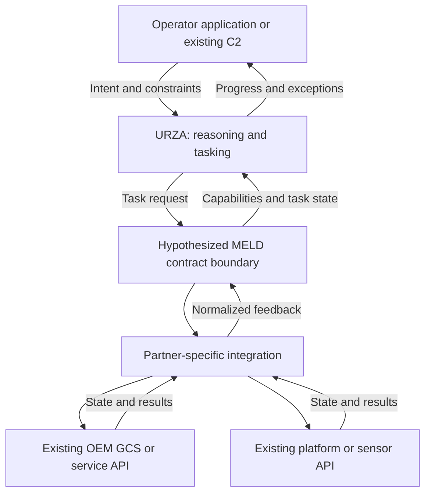
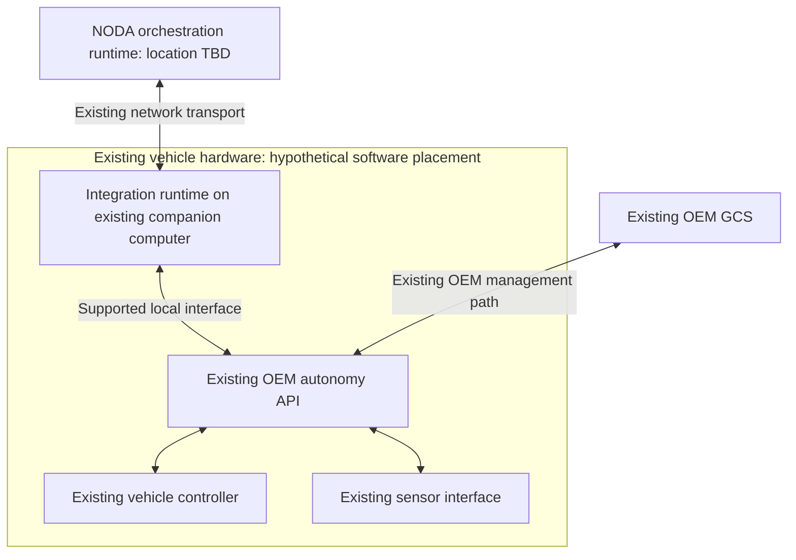

# Architecture Hypotheses

[Back to overview](README.md) · [MELD contract question](questions/01-meld-integration-contract.md) · [Deployment question](questions/02-deployment-location.md)

All four diagrams are candidate hypotheses, not confirmed NODA architecture. Use them to locate interfaces, processes, and ownership during the discussion. See the [public evidence and sources](background-and-sources.md) for the distinction between company statements and interpretations.

## Diagram 1 — Logical responsibilities, before deployment

**Hypothesis H1:** there is a common capability/task contract between orchestration and platform-specific integrations. The named boxes below are conceptual responsibilities; they may be combined, split, or called something else in the actual product.

**Ask while showing it:**

> Which of these boundaries actually exists? Where would you place MELD, the partner adapter, and execution supervision? Is the integration contract primarily about messages, or does it also define capabilities, task states, and failure semantics?

**What the answer changes:** whether the work is primarily protocol adaptation, capability modeling, application state management, or a combination. Ask which box corresponds to a repository or package that the Taiwan engineer would modify.

**Source anchor:** NODA's [URZA and capability-abstraction overview](https://nodaintelligence.ai/) and [platform principles](https://nodaintelligence.ai/solutions/). The specific contract and feedback arrows above are hypotheses.

## Deployment alternatives to test

These are alternatives to compare, not three asserted NODA configurations. Ask which one is representative, which is unsupported, and what is missing. Logical responsibilities and physical deployment are separate questions.

### Diagram 2 — H2: External integration through existing ground interfaces

This develops the original sketch's ground-interface idea while separating an OEM GCS from a NODA adapter. The adapter could be a separate process or host; co-location is not assumed.

**Question:**

> Can a platform be integrated entirely through an existing ground-side API, with its onboard software left unchanged? If so, does NODA talk to an OEM GCS, a headless gateway, or another service? What functionality must that interface expose?

**Evidence that would support H2:** an existing API carries the required requests and feedback, with the adapter deployed outside the vehicle. **Evidence against it for that integration:** required functionality is available only through another interface or a vehicle-side runtime.

**Possible work to confirm:** API adaptation, status normalization, service deployment, connection handling, and integration tests. Ask whether the OEM GCS is an operator UI, an essential execution dependency, or both.

**Source anchor:** NODA's [no-modifications announcement](https://nodaintelligence.ai/news/department-of-war-awards-noda-ai-100-million-to-scale-mission-command-for-autonomous-forces-across-the-joint-force/) motivates testing this interpretation, but does not prove this topology.

### Diagram 3 — H3: A runtime on an existing onboard computer

This is a contrasting hypothesis to challenge, particularly against the no-software-modifications statement. Existing hardware does **not** by itself make installing a new process consistent with that statement.

**Question:**

> Is deploying an integration process on an existing companion computer ever part of the supported model, or would that be outside the no-modifications approach? If it is supported, who installs, updates, and supports that process, and what exactly remains unchanged on the OEM side?

**Evidence that would support H3:** the engineer confirms a supported local software deployment and explains its relationship to the public claim. **Evidence against it:** integration is entirely external, or the only onboard software is the OEM's pre-existing stack.

**Possible work to confirm:** packaging, Linux process supervision, local API integration, resource limits, diagnostics, and compatibility testing. Do not infer a required Jetson, a particular CPU architecture, or new vehicle hardware from this sketch.

**Source anchor:** compare the [hardware-independent positioning](https://nodaintelligence.ai/solutions/) with the broader [hardware-and-software modification claim](https://nodaintelligence.ai/news/department-of-war-awards-noda-ai-100-million-to-scale-mission-command-for-autonomous-forces-across-the-joint-force/).

### Diagram 4 — H4: Mixed integration paths behind one contract

**Hypothesis:** different partners can expose different integration surfaces while presenting a shared capability model upstream. Common semantics would not require identical deployment locations.

**Question:**

> Is the goal to standardize what an integrated capability means while allowing several deployment patterns? If so, which patterns already have reusable SDKs or adapters, and where does a new partner require custom engineering?

**Evidence that would support H4:** examples of at least two supported integration paths using a common contract. **Evidence against it:** one mandatory integration location or interface for all supported partners.

**Possible work to confirm:** reusable adapter design, contract compatibility, partner-specific capability profiles, and a test matrix across supported configurations.

**Source anchor:** NODA's [vendor-neutral platform principles](https://nodaintelligence.ai/solutions/) motivate this question. The three paths and optional onboard adapter are not documented product features.

### How the original sketch has been reframed

| Original assumption | Better question to test |
| --- | --- |
| Each radio network terminates at a GCS that performs translation | Where does the adapter run, and is the GCS UI separate from the integration service? |
| Zenoh is the GCS-to-C2 connection | Which links actually use Zenoh, and is it visible to partner developers? |
| 433 MHz and 915 MHz identify the two example networks | What network services and constraints does each supplied radio expose? The original frequencies were illustrative, not verified NODA bands or deployment choices. |
| Different platforms require different ground radios | What existing network infrastructure is provided, and who owns its integration and qualification? |
| “Champion Computer” | The intended term is **companion computer**; its presence and role remain platform-dependent. |

Neither an RF band nor a middleware name specifies the whole communication path. Ask separately about the application contract, network transport, and supplied radio/network system. Do not infer a custom CDMA network from an interviewer's previous wireless experience.
