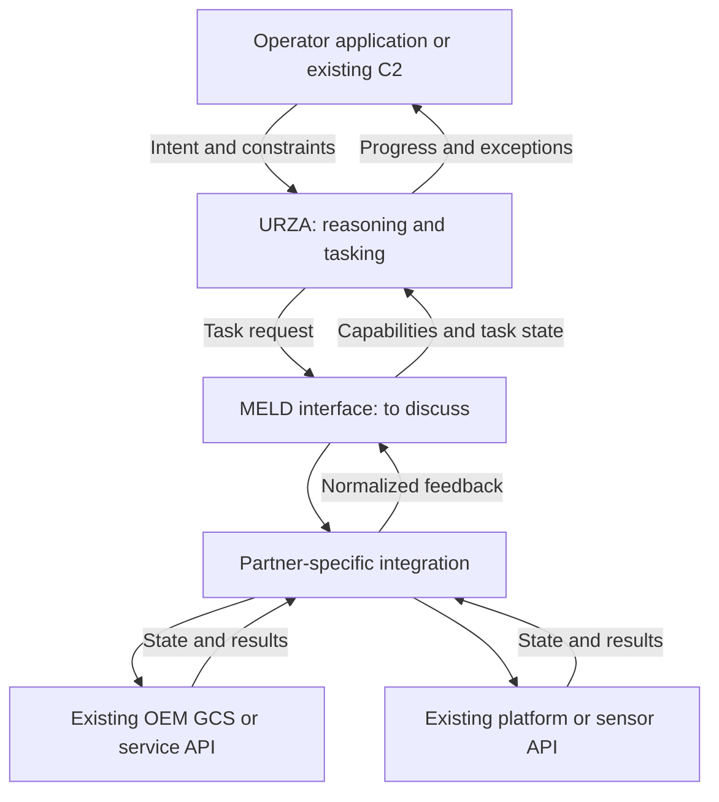
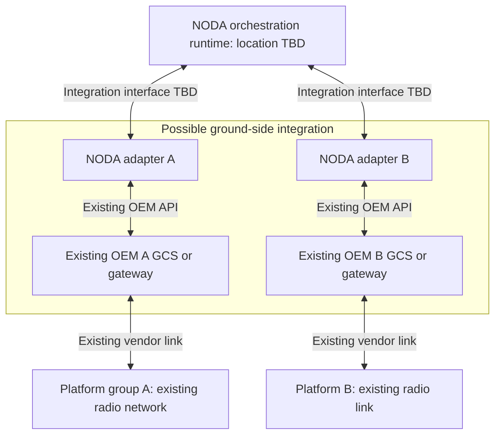
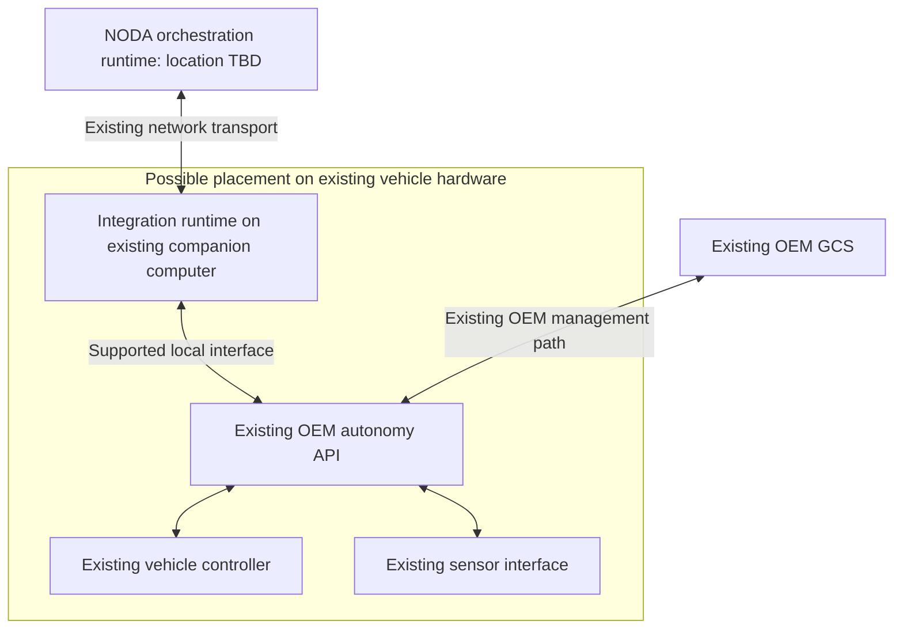
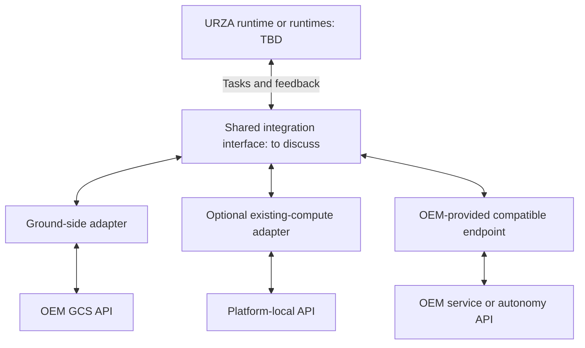

# Integration Sketches

I drew these sketches to help explain my current understanding. The interfaces and deployment locations are assumptions for discussion; I'd appreciate your corrections or a different view that better reflects the system.

## 1. MELD, URZA, and partner interfaces

Does this roughly reflect how URZA, MELD, and partner integrations fit together? Where would you place responsibility for tracking task completion?

Reference: [NODA overview](https://nodaintelligence.ai/). Related: [Working with MELD](questions/01-meld-integration-contract.md) and [From task to completion](questions/03-task-execution-and-supervision.md).

## 2. Integration through a ground-side interface

Could an integration use an existing OEM ground control station or gateway API, as shown here?

Reference: [NODA integration announcement](https://nodaintelligence.ai/news/department-of-war-awards-noda-ai-100-million-to-scale-mission-command-for-autonomous-forces-across-the-joint-force/).

## 3. Integration on an existing onboard computer

Is an integration process on an existing companion computer ever part of the setup? If so, how does it fit with the approach of leaving the OEM platform unchanged?

Reference: [NODA platform principles](https://nodaintelligence.ai/solutions/) and [integration announcement](https://nodaintelligence.ai/news/department-of-war-awards-noda-ai-100-million-to-scale-mission-command-for-autonomous-forces-across-the-joint-force/).

## 4. Different integration paths

Can different partners use different integration paths while exposing a common interface to NODA? Which parts of the integration are usually reusable?

Reference: [NODA platform principles](https://nodaintelligence.ai/solutions/).

[Deployment discussion](questions/02-deployment-location.md) · [All topics](README.md)
